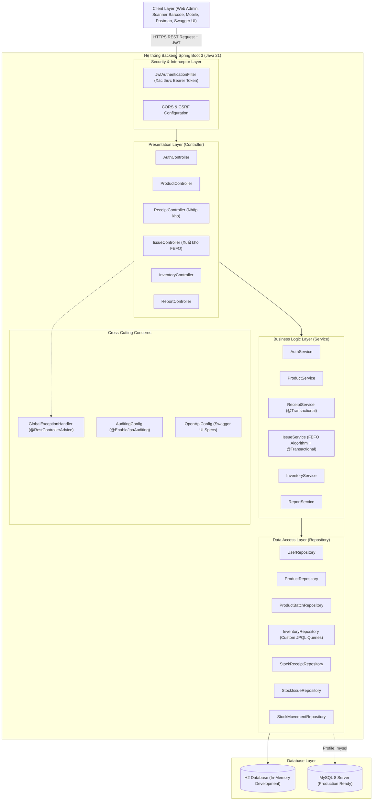
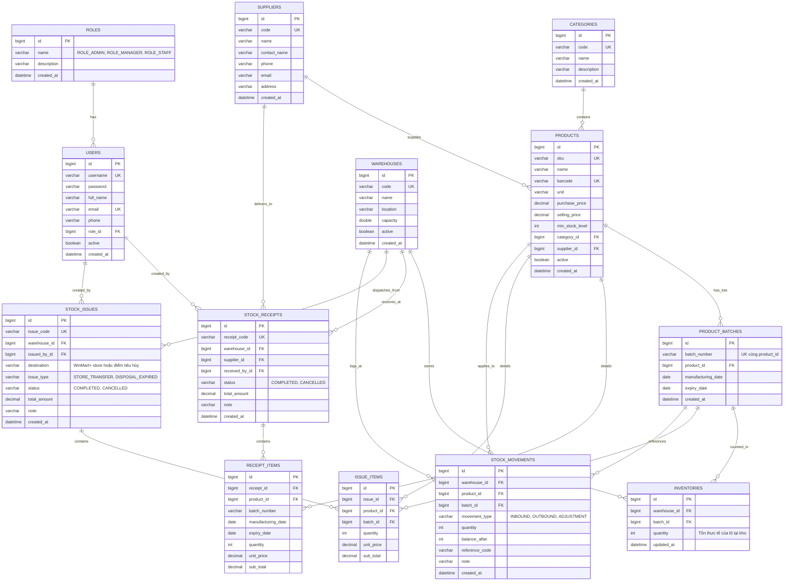
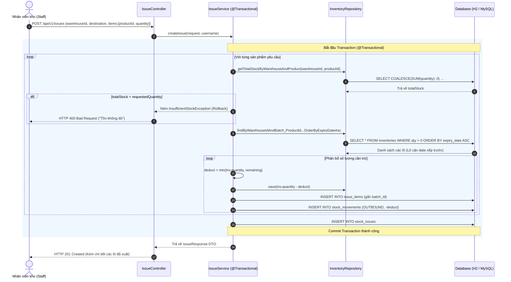

# TÀI LIỆU 02: THIẾT KẾ KIẾN TRÚC & CƠ SỞ DỮ LIỆU
## Đề tài: Hệ Thống Quản Lý Kho Chuỗi Siêu Thị WinMart (WinMart WMS)

---

## 1. TỔNG QUAN KIẾN TRÚC HỆ THỐNG

### 1.1. Kiến trúc phân tầng (3-Tier Layered Architecture)
Hệ thống WinMart WMS được xây dựng theo mô hình kiến trúc phân tầng chuẩn công nghiệp của hệ sinh thái Spring Framework. Kiến trúc này đảm bảo nguyên lý **Đơn nhiệm (Single Responsibility Principle)** và **Phân tách mối quan tâm (Separation of Concerns)**:



### 1.2. Làm nổi bật các thế mạnh cốt lõi của Spring Boot trong đồ án
Dự án được thiết kế có chủ đích nhằm phô diễn tối đa các tính năng quan trọng mà giảng viên/hội đồng đánh giá cao ở một ứng dụng Spring Boot chuyên nghiệp:

1. **Inversion of Control (IoC) & Dependency Injection (DI)**:
   - Sử dụng cơ chế Constructor Injection thông qua `@RequiredArgsConstructor` của Lombok.
   - Các Service, Repository, Filter được container quản lý vòng đời chặt chẽ, giảm sự phụ thuộc cứng (loose coupling) và dễ dàng viết Unit Test với Mockito.
2. **Quản lý Giao dịch Khai báo (Declarative Transaction Management - `@Transactional`)**:
   - Thể hiện rõ nét nhất ở `ReceiptService` và `IssueService`.
   - Khi tạo một phiếu nhập hoặc xuất: Hệ thống phải thực hiện liên hoàn nhiều bước: Lưu thông tin phiếu -> Tìm/tạo Lô -> Cập nhật tăng/giảm tồn kho -> Ghi nhật ký biến động (`StockMovement`).
   - Nếu xảy ra lỗi ở bất kỳ bước nào (ví dụ thiếu tồn kho, vi phạm khóa ngoại), `@Transactional` đảm bảo **Rollback 100%**, giữ cho CSDL luôn ở trạng thái nhất quán tuyệt đối.
3. **Spring Data JPA & Hibernate ORM**:
   - Sử dụng các JPA Derived Query Methods (`findByWarehouseIdAndBatch_ProductId...`).
   - Tối ưu hóa truy vấn bằng JPQL tùy biến (`@Query`) cho bài toán tìm lô cận date và tính tổng số lượng tồn kho.
   - Cơ chế tự động ghi nhận thời gian `@CreatedDate` và `@LastModifiedDate` thông qua `AuditingEntityListener`.
4. **Spring Security 6 & Stateless JWT**:
   - Triển khai `JwtAuthenticationFilter` tự động chặn và giải mã Token trong header `Authorization: Bearer <token>`.
   - Kết hợp `RoleBased Access Control` (RBAC) với `@PreAuthorize("hasRole('ADMIN')")` hoặc `@PreAuthorize("hasAnyRole('ADMIN', 'MANAGER')")` trực tiếp trên từng hàm nghiệp vụ.
5. **Xử lý Ngoại lệ Tập trung (Centralized Exception Handling)**:
   - Thay vì `try-catch` rải rác trong Controller, hệ thống dùng `@RestControllerAdvice` và `@ExceptionHandler`.
   - Chuẩn hóa mã lỗi nghiệp vụ (`RESOURCE_NOT_FOUND`, `INSUFFICIENT_STOCK`, `UNAUTHORIZED`,...) và tự động map HTTP status tương ứng.
6. **Spring Validation (`jakarta.validation`)**:
   - Kiểm tra tính hợp lệ dữ liệu ngay từ tầng tiếp nhận (`@Valid`, `@NotBlank`, `@Min`, `@DecimalMin`).
   - Trả về danh sách chi tiết các trường bị lỗi định dạng cho Client.
7. **Tài liệu hóa Tự động với Springdoc OpenAPI 3**:
   - Tự động quét toàn bộ Controller và sinh Swagger UI tương tác trực tiếp mà không cần viết tay file tài liệu API riêng biệt.

---

## 2. THIẾT KẾ CƠ SỞ DỮ LIỆU (DATABASE SCHEMA)

### 2.1. Sơ đồ Thực thể Liên kết (Entity Relationship Diagram - ERD)



### 2.2. Từ điển Dữ liệu (Data Dictionary - Các bảng trọng tâm)

#### Bảng `product_batches` (Lô sản xuất & Hạn sử dụng)
| Tên cột | Kiểu dữ liệu | Ràng buộc | Ý nghĩa |
| :--- | :--- | :--- | :--- |
| `id` | BIGINT | PK, AUTO_INCREMENT | Khóa chính |
| `batch_number` | VARCHAR(50) | NOT NULL | Số lô sản xuất (Ví dụ: `LOT-VNM-2601`) |
| `product_id` | BIGINT | FK -> products(id), NOT NULL | Sản phẩm thuộc lô |
| `manufacturing_date` | DATE | NULL | Ngày sản xuất |
| `expiry_date` | DATE | NOT NULL | Hạn sử dụng (Dùng cho FEFO & Cảnh báo) |
| *Ràng buộc duy nhất* | UK(product_id, batch_number) | | Một sản phẩm không có 2 lô trùng số hiệu |

#### Bảng `inventories` (Số lượng tồn kho theo lô)
| Tên cột | Kiểu dữ liệu | Ràng buộc | Ý nghĩa |
| :--- | :--- | :--- | :--- |
| `id` | BIGINT | PK, AUTO_INCREMENT | Khóa chính |
| `warehouse_id` | BIGINT | FK -> warehouses(id), NOT NULL | Kho lưu trữ |
| `batch_id` | BIGINT | FK -> product_batches(id), NOT NULL | Lô hàng lưu trữ |
| `quantity` | INT | NOT NULL, DEFAULT 0 | Số lượng còn tồn thực tế |
| *Ràng buộc duy nhất* | UK(warehouse_id, batch_id) | | Một kho chỉ có 1 dòng tồn cho mỗi lô |

#### Bảng `stock_movements` (Lịch sử biến động kho)
| Tên cột | Kiểu dữ liệu | Ràng buộc | Ý nghĩa |
| :--- | :--- | :--- | :--- |
| `id` | BIGINT | PK, AUTO_INCREMENT | Khóa chính |
| `warehouse_id` | BIGINT | FK, NOT NULL | Kho phát sinh biến động |
| `product_id` | BIGINT | FK, NOT NULL | Sản phẩm biến động |
| `batch_id` | BIGINT | FK, NOT NULL | Lô hàng biến động |
| `movement_type` | VARCHAR(30) | NOT NULL | `INBOUND`, `OUTBOUND`, `ADJUSTMENT` |
| `quantity` | INT | NOT NULL | Số lượng (+ với Inbound, - với Outbound) |
| `balance_after` | INT | NOT NULL | Số tồn sau giao dịch |
| `reference_code` | VARCHAR(50) | NULL | Mã phiếu nhập/xuất liên quan |

---

## 3. THIẾT KẾ QUY TRÌNH NGHIỆP VỤ & SƠ ĐỒ TUẦN TỰ (SEQUENCE DIAGRAM)

### 3.1. Sơ đồ tuần tự: Xuất kho theo thuật toán FEFO (Outbound Flow)
Đây là quy trình nghiệp vụ quan trọng nhất của đồ án, thể hiện sự kết hợp giữa **thuật toán FEFO** và **Spring Transaction**:



---

## 4. TỔ CHỨC CẤU TRÚC GÓI MÃ NGUỒN (PACKAGE ARCHITECTURE)

```text
com.winmart.wms
│
├── WinmartWmsApplication.java          # Lớp Boot khởi chạy ứng dụng
│
├── common/                             # Các thành phần tái sử dụng toàn hệ thống
│   ├── ApiResponse.java                # Chuẩn hóa vỏ bọc kết quả {success, message, data, timestamp}
│   ├── PageResponse.java               # Chuẩn hóa phân trang {content, pageNo, pageSize, totalElements}
│   └── BaseEntity.java                 # Entity cha cung cấp id, createdAt, updatedAt
│
├── config/                             # Cấu hình Spring Context
│   ├── AuditingConfig.java             # Kích hoạt JPA Auditing
│   ├── OpenApiConfig.java              # Cấu hình Swagger UI 3 tích hợp Bearer JWT
│   └── DataInitializer.java           # CommandLineRunner nạp dữ liệu mẫu ban đầu
│
├── entity/                             # Các thực thể JPA ánh xạ CSDL
│   ├── enums/                          # RoleName, ReceiptStatus, IssueType, MovementType...
│   ├── User.java, Role.java
│   ├── Category.java, Supplier.java, Warehouse.java, Product.java
│   ├── ProductBatch.java, Inventory.java
│   ├── StockReceipt.java, ReceiptItem.java
│   ├── StockIssue.java, IssueItem.java
│   └── StockMovement.java
│
├── repository/                         # Tầng thao tác dữ liệu Spring Data JPA
│   ├── UserRepository.java, RoleRepository.java
│   ├── CategoryRepository.java, SupplierRepository.java, WarehouseRepository.java
│   ├── ProductRepository.java, ProductBatchRepository.java
│   ├── InventoryRepository.java       # Các câu truy vấn FEFO và cảnh báo cận date
│   ├── StockReceiptRepository.java, StockIssueRepository.java
│   └── StockMovementRepository.java
│
├── dto/                                # Data Transfer Objects
│   ├── auth/ (LoginRequest, RegisterRequest, AuthResponse, UserProfileResponse)
│   ├── category/ (CategoryRequest, CategoryResponse)
│   ├── supplier/ (SupplierRequest, SupplierResponse)
│   ├── warehouse/ (WarehouseRequest, WarehouseResponse)
│   ├── product/ (ProductRequest, ProductResponse)
│   ├── receipt/ (ReceiptCreateRequest, ReceiptResponse...)
│   ├── issue/ (IssueCreateRequest, IssueResponse...)
│   ├── inventory/ (InventoryResponse, ExpiringBatchResponse, LowStockResponse...)
│   └── report/ (DashboardStatsResponse)
│
├── service/                            # Tầng xử lý nghiệp vụ chính
│   ├── AuthService.java
│   ├── CategoryService.java, SupplierService.java, WarehouseService.java
│   ├── ProductService.java
│   ├── ReceiptService.java            # Nghiệp vụ nhập kho & tăng tồn
│   ├── IssueService.java              # Nghiệp vụ xuất kho FEFO & trừ tồn
│   ├── InventoryService.java          # Cảnh báo date, tồn an toàn, biến động kho
│   └── ReportService.java             # Thống kê Dashboard
│
├── controller/                         # Tầng RESTful Controller
│   ├── AuthController.java
│   ├── CategoryController.java, SupplierController.java, WarehouseController.java
│   ├── ProductController.java
│   ├── ReceiptController.java
│   ├── IssueController.java
│   ├── InventoryController.java
│   └── ReportController.java
│
├── security/                           # Tầng bảo mật Spring Security & JWT
│   ├── CustomUserDetails.java
│   ├── UserDetailsServiceImpl.java
│   ├── JwtTokenProvider.java
│   ├── JwtAuthenticationFilter.java
│   └── SecurityConfig.java
│
└── exception/                          # Tầng xử lý lỗi tập trung
    ├── ErrorCode.java
    ├── AppException.java
    ├── ResourceNotFoundException.java
    ├── InsufficientStockException.java
    ├── BadRequestException.java
    └── GlobalExceptionHandler.java
```
